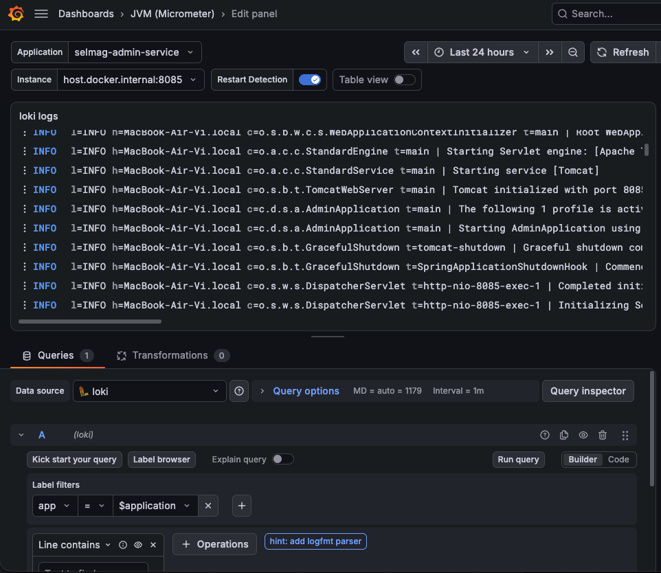

# Мониторинг: метрики, логи и трейсы

Практическая инструкция: что запущено, какие адреса использовать, какие datasource'ы завести в Grafana и где смотреть каждый тип данных. Зачем нужны VictoriaMetrics, Loki, Tempo и почему выбран OTLP, а не Zipkin, — в `README.MD`.

## Общая картина

```
приложения :8080/8081/8083/8084/8085
   │
   ├── GET /actuator/prometheus  ──(pull, раз в 60 с)──►  VictoriaMetrics :8428  ──►  Grafana :3000
   │
   ├── push логов (если задан LOKI)  ──────────────────►  Loki :3100             ──►  Grafana :3000
   │
   └── OTLP/HTTP (пока только customer-app)  ──────────►  Tempo :3200 (4317/4318) ──►  Grafana :3000
```

Метрики VictoriaMetrics **забирает сама** (pull). Логи и трейсы приложения **отправляют сами** (push). Grafana — единая точка просмотра: она ходит в datasource'ы со своей стороны, поэтому браузеру не нужны внутренние адреса контейнеров.

## Компоненты и адреса

| Компонент | Контейнер | Адрес с хоста | Что хранит | Переживает пересоздание контейнера? |
|---|---|---|---|---|
| Grafana | `selmag-grafana` | http://127.0.0.1:3000 | datasource'ы и дашборды в `./data/grafana` | да, каталог смонтирован |
| VictoriaMetrics | `selmag-metrics` | http://127.0.0.1:8428 | метрики | нет, без volume |
| Loki | `selmag-loki` | http://127.0.0.1:3100 | логи | нет, без volume |
| Tempo | `selmag-tempo` | http://127.0.0.1:3200, OTLP `4317`/`4318` | трейсы | нет, без volume |
| Keycloak | `selmag-keycloak` | http://127.0.0.1:8082 | — (нужен для OAuth2-скрапа) | нет, dev-режим |

Команды запуска контейнеров — в `README.MD`. Grafana: `admin` / `admin`, при первом входе попросит сменить пароль.

## Два вида адресов: `127.0.0.1` и `host.docker.internal`

Правило простое:

- **браузер на хосте и приложения на хосте** ходят по `127.0.0.1` / `localhost`;
- **Grafana внутри контейнера** при настройке datasource'а ходит по `http://host.docker.internal:<порт>`.

Причина: `127.0.0.1` внутри контейнера — это сам контейнер, а не ваш Mac. `host.docker.internal` — специальное имя, которое Docker Desktop резолвит в хост.

| Кто обращается | К чему | Адрес |
|---|---|---|
| Браузер | Grafana UI | `http://127.0.0.1:3000` |
| Браузер | VictoriaMetrics UI | `http://127.0.0.1:8428/vmui/` |
| Grafana (контейнер) | datasource Prometheus/VictoriaMetrics | `http://host.docker.internal:8428` |
| Grafana (контейнер) | datasource Loki | `http://host.docker.internal:3100` |
| Grafana (контейнер) | datasource Tempo | `http://host.docker.internal:3200` |
| Приложение на хосте | Loki (push) | `http://127.0.0.1:3100` |
| Приложение на хосте | Tempo (OTLP) | `http://localhost:4318/v1/traces` |
| VictoriaMetrics (контейнер) | приложения | `http://host.docker.internal:8080…8085` |
| VictoriaMetrics (контейнер) | Keycloak за токеном | `http://host.docker.internal:8082` |

На Linux `host.docker.internal` по умолчанию не работает: добавьте контейнеру `--add-host=host.docker.internal:host-gateway` или используйте адрес bridge-сети (обычно `172.17.0.1`).

## Datasource'ы в Grafana

Grafana → **Connections** → **Data sources** → **Add new data source** → выбрать тип → указать URL → **Save & test**.

| Имя | Тип | URL внутри Grafana | Для чего |
|---|---|---|---|
| `VictoriaMetrics` | Prometheus | `http://host.docker.internal:8428` | метрики |
| `loki` | Loki | `http://host.docker.internal:3100` | логи |
| `tempo` | Tempo | `http://host.docker.internal:3200` | трейсы |

`Access` оставьте `Server` (значение по умолчанию): запросы проксирует контейнер Grafana, браузеру `host.docker.internal` не нужен.

Datasource'ы и дашборды хранятся в `./data/grafana/grafana.db` (каталог в `.gitignore`), а не в репозитории. На свежем клоне или после удаления `data/grafana` их нужно создать заново. Каталоги `config/grafana/provisioning` и `config/grafana/dashboards` пока пустые — это задел на будущий автоматический provisioning.

## Метрики

Приложения не отправляют метрики сами — они лишь отдают текущий снимок на `/actuator/prometheus`. Все эндпоинты `/actuator/**` защищены scope `SCOPE_metrics`, поэтому прямой `curl` без токена вернёт 401 — это нормально. `selmag-metrics` получает токен сам: в `config/victoria-metrics/promscrape.yaml` для каждого job'а настроен `oauth2` с `client_credentials` (клиент `victoria-metrics` в Keycloak, scope `metrics`).

В конфиге пять job'ов — по одному на сервис, у метрик есть метка `application`:

| job | application |
|---|---|
| `selmag_manager_app` | `selmag-manager-app` |
| `selmag_catalogue_service` | `selmag-catalogue-service` |
| `selmag_customer_app` | `selmag-customer-app` |
| `selmag_feedback_service` | `selmag-feedback-service` |
| `selmag_admin_service` | `selmag-admin-service` |

Интервал скрапа по умолчанию — **60 секунд**. Если нужен чаще, добавьте в job (или глобально) `scrape_interval: 15s`.

Где смотреть:

- **vmui** — `http://127.0.0.1:8428/vmui/`: ad-hoc запросы, графики, таблицы;
- **статус скрапа** — `http://127.0.0.1:8428/targets` (или `http://127.0.0.1:8428/api/v1/targets`): видно, какие target'ы `up`, ошибки и время последнего скрапа;
- **Grafana Explore** — datasource `VictoriaMetrics`;
- **дашборд JVM (Micrometer)** — см. ниже.

Полезные запросы:

| Запрос | Что показывает |
|---|---|
| `up{job="selmag_customer_app"}` | 1 — сервис отвечает, 0 — нет |
| `rate(http_server_requests_seconds_count[5m])` | запросов в секунду |
| `rate(http_server_requests_seconds_sum[5m]) / rate(http_server_requests_seconds_count[5m])` | средняя длительность запроса |
| `jvm_memory_used_bytes{area="heap"}` | занятая heap |
| `rate(jvm_gc_pause_seconds_sum[5m])` | время в GC |

Гистограммных бакетов (`http_server_requests_seconds_bucket`) сейчас нет, поэтому `histogram_quantile` вернёт пусто — используйте среднее через `sum/count`.

## Логи

Логи отправляет `Loki4jAppender` из `logback.xml`. Он включается только когда задана переменная окружения `LOKI`:

```bash
SPRING_PROFILES_ACTIVE=standalone LOKI=http://127.0.0.1:3100 \
  ./mvnw -pl manager-app spring-boot:run
```

Без `LOKI` приложение пишет только в консоль. Так сделано и для тестов: без переменной аппендер не создаётся и не пытается достучаться до Loki.

Appender шлёт метки `app`, `host`, `level`; `service_name` и `detected_level` добавляет уже сам Loki. Значения `app`:

`selmag-admin-service`, `selmag-catalogue-service`, `selmag-customer-app`, `selmag-feedback-service`, `selmag-manager-app`.

Где смотреть: Grafana → **Explore** → datasource `loki`:

```logql
{app="selmag-manager-app"}
{app="selmag-manager-app", level="ERROR"}
{app="selmag-customer-app"} |= "ERROR"
```

Loki буферизует записи: батч уходит раз в 60 секунд (или при 1000 записях), поэтому свежие логи появляются не мгновенно. Своего UI у Loki нет — только API на `:3100`, смотреть удобнее в Grafana.

## Трейсы

Трейсы пока отправляет только `customer-app`: `spring-boot-starter-opentelemetry` шлёт спаны по OTLP/HTTP на `http://localhost:4318/v1/traces`. В Tempo сервис называется `selmag-customer-app` (`spring.application.name`), сэмплирование локально — `1.0` (100%).

Где смотреть: Grafana → **Explore** → datasource `tempo` → **Search**:

- Service Name — `selmag-customer-app`;
- Span Name — например, `http get /customer/products/{productId}`;
- либо TraceQL: `{resource.service.name="selmag-customer-app"}`, `{name="http get /actuator/prometheus"}`.

В трейсе видны HTTP-спан и вложенные спаны Spring Security: `security filterchain before`, `authorize exchange`, `secured request`, `security filterchain after`.

Особенности:

- Tempo индексирует трейсы с задержкой до минуты — не пугайтесь пустому поиску сразу после запроса;
- VictoriaMetrics каждую минуту скрапит `/actuator/prometheus`, поэтому в Tempo много трейсов вида `http get /actuator/prometheus` — это нормальный шум, фильтруйте по имени спана;
- данные Tempo без volume теряются при пересоздании контейнера.

## Дашборд JVM (Micrometer) и панель логов из Loki

### Импорт дашборда

1. Grafana → **Dashboards** → **New** → **Import**.
2. В поле **Import via grafana.com** введите ID `4701` → **Load**.
3. Выберите datasource **VictoriaMetrics** (панели дашборда используют Prometheus-совместимый тип; в текущей Grafana у него uid `prometheus`).
4. **Import**.

У дашборда две переменные: `application` (`label_values(application)`) и `instance` (`label_values(jvm_memory_used_bytes{application="$application"}, instance)`). После импорта подождите хотя бы один скрап (до 60 секунд), иначе списки значений будут пустыми.

### Добавление панели логов

1. Откройте дашборд **JVM (Micrometer)** → **Add** → **Visualization**.
2. Datasource — `loki`.
3. Запрос: `{app="$application"}` (в Builder: label `app` = `$application`).
4. Тип визуализации — **Logs**.
5. Panel options → **Title**: `loki logs`.
6. Logs options: **Show timestamps** выключить, **Display log level** включить.
7. **Apply** → **Save**.

Почему это работает: значения переменной `application` (`selmag-manager-app`, `selmag-customer-app`, …) совпадают с меткой `app`, которую appender пишет в Loki. Одна переменная фильтрует и метрики, и логи.

Пример панели:



Если панель пустая: приложение запущено без `LOKI`, ещё не прошёл 60-секундный батч или выбрано другое значение `application`.

## Быстрая самопроверка

```bash
# VictoriaMetrics жива и видит цели
curl -s http://127.0.0.1:8428/health
curl -s http://127.0.0.1:8428/api/v1/targets | python3 -m json.tool | head -40

# Loki принимает запросы
curl -s http://127.0.0.1:3100/ready
curl -s http://127.0.0.1:3100/loki/api/v1/labels

# Tempo готов принимать трейсы
curl -s http://127.0.0.1:3200/ready

# Grafana жива
curl -s http://127.0.0.1:3000/api/health
```

Ожидаемо: VictoriaMetrics показывает 5 активных target'ов с `health: up`; `/loki/api/v1/labels` возвращает `["app","host","level",...]`; Tempo отвечает `ready`; Grafana — `{"database":"ok",...}`.

Типичные ошибки:

| Симптом | Причина | Что делать |
|---|---|---|
| Datasource «connection refused» / timeout | внутри Grafana указан `127.0.0.1` | заменить на `host.docker.internal` |
| target `down` в VictoriaMetrics | приложение не запущено, Keycloak недоступен или нет scope `metrics` | открыть `/targets`, проверить приложение и токен |
| `/actuator/prometheus` отдаёт 401 в браузере | эндпоинт защищён | это нормально; VictoriaMetrics ходит со своим токеном |
| В Loki нет логов | не задан `LOKI` или не прошёл батч | проверить env, подождать до минуты |
| В Tempo нет трейсов | Tempo не запущен или сервис не `customer-app` | `curl :3200/ready`, смотреть Service Name |
| Пустой JVM-дашборд | не выбран datasource или ещё не было скрапа | выбрать `VictoriaMetrics`, подождать 60 с |

## Kubernetes: что изменится (на будущее)

Манифестов в репозитории пока нет — это концептуальная заметка, а не инструкция.

- **Адреса.** `host.docker.internal` исчезает: всё внутри кластера общается по Service DNS. Datasource'ы Grafana: `http://victoria-metrics:8428`, `http://loki:3100`, `http://tempo:3200`. Приложения: `LOKI=http://loki:3100`, OTLP — `http://tempo:4318/v1/traces`. Между namespace используйте FQDN вида `loki.monitoring.svc.cluster.local`. `Access = Server` остаётся правильным.
- **Keycloak.** Внутри кластера его порт — `8080`. Значение `iss` определяется `hostname` Keycloak, а `issuer-uri` всех сервисов должен совпадать с `iss` (обычно это внешний Ingress-URL). `token_url` для скрапа может ходить по внутреннему DNS. Вместо `start-dev` — `start` с базой данных.
- **Скрапинг.** Вместо статических target'ов — `kubernetes_sd_configs` (роли `endpoints`/`pods`, RBAC, relabeling, метка `application`) или VictoriaMetrics Operator (`VMServiceScrape`). Для маленького демо статические Service DNS-адреса тоже подойдут.
- **Probes.** Группы `/actuator/health/liveness` и `/actuator/health/readiness` есть, но в четырёх сервисах `/actuator/**` закрыт `SCOPE_metrics`, поэтому kubelet без токена получит 401. Варианты: `permitAll` только для health-групп, отдельный management-порт или TCP/exec-probe.
- **Конфиги и секреты.** `promscrape.yaml` содержит client secret — ему место в Secret; остальное (Tempo, Loki-настройки, dashboard JSON) — в ConfigMap. Provisioning Grafana позволит не создавать datasource'ы руками.
- **Хранение.** PVC для VictoriaMetrics, Loki, Tempo и Grafana (или полный provisioning); для stateful-компонентов — StatefulSet и `ReadWriteOnce`; настроить retention.
- **Приложения.** Сейчас адреса PostgreSQL, MongoDB, Keycloak, catalogue/feedback и admin-server прописаны как `localhost` в `application-standalone.yml`; для k8s нужен отдельный профиль или переменные окружения с Service DNS.
- **Доступ.** Браузер — через Ingress или `kubectl port-forward svc/grafana 3000:3000`. VictoriaMetrics, Loki и Tempo наружу не публиковать: у них нет аутентификации.
- **OTel Collector (опционально).** Deployment + Service между приложениями и Tempo: приложения шлют на `http://otel-collector:4318/v1/traces`, коллектор добавляет батчинг, ретраи и sampling. Каталог `config/otel-collector` пока пуст.
- **Что не меняется.** Grafana остаётся единой точкой просмотра, datasource'ы всё так же `Access = Server`, модели данных (метрики/логи/трейсы) те же. `host.docker.internal` нужен только для компонентов, запущенных вне кластера (приложение или Grafana на хосте) — тогда используйте port-forward.
