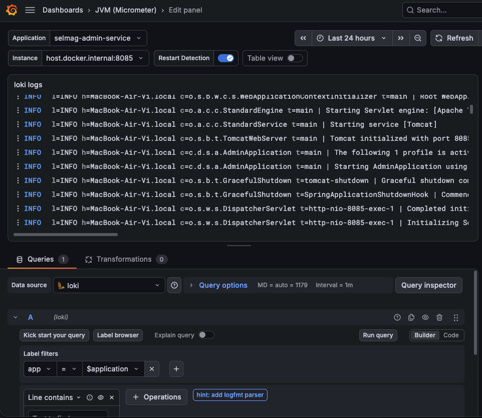

docker run --name catalogue-db -p 5432:5432 -e POSTGRES_DB=catalogue -e POSTGRES_USER=catalogue -e POSTGRES_PASSWORD=catalogue postgres:17.4-alpine

docker run --name manager-db -p 5433:5432 -e POSTGRES_DB=manager -e POSTGRES_USER=manager -e POSTGRES_PASSWORD=manager postgres:17.4-alpine

docker run --name selmag-keycloak -p 8082:8080 -e KC_BOOTSTRAP_ADMIN_USERNAME=admin -e KC_BOOTSTRAP_ADMIN_PASSWORD=admin -v ./config/keycloak/import:/opt/keycloak/data/import quay.io/keycloak/keycloak:26.1.3 start-dev --import-realm --hostname=http://localhost:8082 --hostname-strict=true

docker run --name feedback-db -p 27017:27017 mongo:8

docker exec -it feedback-db mongosh feedback

docker run --name selmag-metrics -p 8428:8428 -v ./config/victoria-metrics/promscrape.yaml:/promscrape.yaml victoriametrics/victoria-metrics:v1.155.0 -promscrape.config=promscrape.yaml

mkdir -p data/grafana

docker run --name selmag-grafana -p 3000:3000 -v ./data/grafana:/var/lib/grafana -u "$(id -u)" grafana/grafana:13.3.0

docker run --name selmag-loki -p 3100:3100 grafana/loki:3.6.20

docker run --name selmag-tempo -p 3200:3200 -p 4317:4317 -p 4318:4318 -v ./config/tempo/tempo.yaml:/etc/tempo.yaml grafana/tempo:3.1.1 -config.file=/etc/tempo.yaml

lsof -i tcp:3000
kill -9 <PID>

`--hostname=http://localhost:8082 --hostname-strict=true` фиксируют issuer Keycloak. Без фиксированного hostname `start-dev` подставляет в `iss` хост из запроса: токен, запрошенный контейнером (VictoriaMetrics) через `host.docker.internal:8082`, получил бы `iss=http://host.docker.internal:8082/realms/selmag` и не прошёл бы валидацию в сервисах с `issuer-uri: http://localhost:8082/realms/selmag` (401). С этими флагами `iss` всегда `http://localhost:8082/realms/selmag`, независимо от того, по какому адресу контейнер обратился к Keycloak (`host.docker.internal:8082` на macOS, `172.17.0.1:8082` на Linux).

**Профиль `standalone` и запуск приложений.** Все сервисы держат локальную конфигурацию в `application-standalone.*` (порты, datasource/MongoDB, Keycloak, management-эндпоинты), поэтому запускать их нужно **с профилем `standalone`** — без него эти файлы не загрузятся:

```bash
SPRING_PROFILES_ACTIVE=standalone ./mvnw -pl manager-app spring-boot:run
# эквивалент: ./mvnw -pl manager-app spring-boot:run -Dspring-boot.run.profiles=standalone
```

Чтобы сервис дополнительно отправлял логи в Loki, добавьте переменную окружения `LOKI` с адресом Loki:

```bash
SPRING_PROFILES_ACTIVE=standalone LOKI=http://127.0.0.1:3100 \
  ./mvnw -pl manager-app spring-boot:run
```

`LOKI` должна быть видна процессу приложения: переменная окружения при запуске из терминала или поле **Environment variables** в run configuration IDE. Без неё приложение пишет логи как обычно — только в консоль.

**Зачем VictoriaMetrics.** Приложения не отправляют метрики сами — они лишь экспонируют текущий снимок на `/actuator/prometheus`, а `selmag-metrics` раз в 60 с (по умолчанию) скрапит его (`config/victoria-metrics/promscrape.yaml`) и хранит сэмплы с таймстампами в своей TSDB. Поэтому история переживает падение и рестарт приложения (Spring Boot Admin показывает только «сейчас»), виден сам факт падения (`up{job="…"} == 0`, разрыв в скрапах) и значения до него, а все сервисы собираются в одном месте — по этой истории строятся дашборды и алерты. Посмотреть метрики без дашбордов — `http://localhost:8428/vmui/`.

**Зачем Grafana.** VictoriaMetrics хранит и отдаёт метрики, но её `vmui` — инструмент для ad-hoc запросов: постоянных дашбордов с панелями и переменными, алертов и общего доступа там нет. Grafana — отдельный слой визуализации поверх VM (и других источников): дашборды (в том числе как JSON в репозитории), панели и переменные, алерты, аутентификация и шаринг. Для базового просмотра метрик она не обязательна. Доступна по `http://localhost:3000/`, дефолтные креды `admin`/`admin` (при первом входе попросит сменить пароль). Чтобы подключить метрики: `http://localhost:3000/connections/datasources` → **Add new data source** → **Prometheus**, URL — `http://host.docker.internal:8428` (VM отдаёт Prometheus-совместимый API; `Access` оставить `Server` — запросы проксирует сам контейнер Grafana, браузеру `host.docker.internal` не нужен).

**Зачем Loki.** VictoriaMetrics хранит только метрики; логи приложений — это отдельный тип данных, и `selmag-loki` собирает и хранит их, чтобы в Grafana можно было рядом с графиками смотреть и искать логи сервисов. Чтобы подключить: `http://localhost:3000/connections/datasources` → **Add new data source** → **Loki**, URL — `http://host.docker.internal:3100` (`Access` оставить `Server` — запросы проксирует контейнер Grafana).

**Откуда логи в Loki.** Сейчас логи в Loki шлют все пять сервисов: `admin-server`, `catalogue-service`, `customer-app`, `feedback-service` и `manager-app`. `src/main/resources/logback.xml` каждого из них содержит `Loki4jAppender`, который отправляет записи в `${LOKI}/loki/api/v1/push` с метками `app`, `host`, `level` (значение `app` своё у каждого сервиса — `selmag-admin-service`, `selmag-catalogue-service`, `selmag-customer-app`, `selmag-feedback-service`, `selmag-manager-app`). Включается это переменной окружения `LOKI` (например, `SPRING_PROFILES_ACTIVE=standalone LOKI=http://127.0.0.1:3100 ./mvnw -pl manager-app spring-boot:run`); без неё приложение пишет логи как обычно — только в консоль. В Grafana логи конкретного сервиса выбираются селектором вида `{app="selmag-manager-app"}`. Учтите, что loki4j буферизует записи: по умолчанию батч отправляется раз в 60 секунд (или при заполнении 1000 записей), поэтому в Loki логи появляются не мгновенно. Панель с логами в дашборде JVM (Micrometer) выглядит так:



**Зачем Tempo.** VictoriaMetrics хранит метрики, Loki — логи, а распределённые трейсы — Grafana Tempo. `customer-app` отправляет OTLP-спаны по HTTP на `http://localhost:4318/v1/traces` (`management.opentelemetry.tracing.export.otlp.endpoint` в `application-standalone.yml`), Tempo принимает их на порту `4318` и отдаёт Grafana по `3200`. Экспорт идёт напрямую в Tempo, без OTel Collector. Если Tempo не запущен, приложение продолжает работать, но пишет в лог ошибки экспорта и теряет трейсы. Сэмплирование выставлено в `1.0` (100%) только для локальной демонстрации — по умолчанию Spring Boot сэмплирует 10%; для реального окружения верните `0.1`. Хранилище в контейнере без volume, поэтому после его пересоздания трейсы пропадают.

**Почему не Zipkin.** Zipkin — отдельный сервер трейсов со своим UI. В старом типовом стеке Spring Boot (Spring Cloud Sleuth) трейсы обычно отправляли именно в него, а за трассировку отвечал Brave. Мы его не используем по трём причинам: в Spring Boot 4 zipkin-автоконфигурация через OpenTelemetry уже помечена как deprecated (её удалят в 4.2); Tempo принимает стандартный протокол OTLP «из коробки», без прослоек; и главное — не нужно поднимать ещё один бэкенд и ещё один UI: трейсы, метрики и логи смотрятся в одной Grafana.

**Какая сейчас «мета» — OpenTelemetry.** Раньше приложение жёстко зависело от конкретного трейс-бэкенда (Brave → Zipkin). Теперь стандарт — OpenTelemetry: приложение создаёт спаны через Micrometer Tracing, OTel SDK упаковывает их в протокол OTLP и отправляет по HTTP или gRPC. Бэкенд стал заменяемым: Tempo, Jaeger, Grafana Cloud, любой сервис с OTLP-приёмником — меняется только адрес в `management.opentelemetry.tracing.export.otlp.endpoint`, код не трогаем. Поэтому в `pom.xml` стоит `spring-boot-starter-opentelemetry`, а не zipkin-стартер. OTLP — общий протокол и для метрик, и для логов, но у нас метрики пока идут в Prometheus-формате, а логи — в Loki.

Чтобы подключить трейсы в Grafana: `http://localhost:3000/connections/datasources` → **Add new data source** → **Tempo**, URL — `http://host.docker.internal:3200` (`Access` оставить `Server`; на Linux вместо `host.docker.internal` нужен адрес хоста, например `172.17.0.1`). Затем **Explore** → **Tempo** → **Search**: Service Name — `selmag-customer-app`, Span Name — например `http get /customer/products/{productId}` (или TraceQL `{name="http get /customer/products/{productId}"}`). В открывшемся трейсе видны корневой HTTP-спан и вложенные спаны Spring Security: `security filterchain before`, `authorize exchange`, `secured request`, `security filterchain after`.

Быстрая проверка, что экспорт работает, не требует входа в storefront: VictoriaMetrics скрапит `/actuator/prometheus` раз в минуту, поэтому в Tempo появятся трейсы с корневым спаном `http get /actuator/prometheus`. Это шум для демонстрации — нужный трейс ищите по имени спана. Чтобы увидеть трейс страницы товара, запустите с профилем `standalone` Keycloak, `catalogue-service`, `feedback-service` и `customer-app`, войдите как `j.daniels` / `password` и откройте `http://localhost:8083/customer/products/1`. Трейсы появляются не мгновенно: экспортёр отправляет батчи раз в 5 секунд, а Tempo индексирует их для поиска ещё с задержкой до минуты.

**Зачем `condition` в `logback.xml`.** `<condition class="ch.qos.logback.core.boolex.IsPropertyDefinedCondition"><key>LOKI</key></condition>` перед `<if>` — это условная конфигурация logback (появилась в 1.5.20, Janino для неё не нужна): аппендер `LOKI` создаётся только если свойство `LOKI` определено (ищется в env-переменных, `-D` и системных свойствах). Нужно это для интеграционных тестов (и CI), где Loki не запущен: без аппендера приложение не пытается подключиться к `http://127.0.0.1:3100`, не сыплет ошибками отправки в лог тестов и стартует с одним `CONSOLE`-аппендером.

**Папка `data/grafana`.** Мы создаём только пустой каталог (`mkdir -p data/grafana`); файлы в нём появляются при первом старте Grafana и дальше наполняются автоматически. `./data/grafana` смонтирован в `/var/lib/grafana` — это `[paths] data` Grafana: внутри `grafana.db` (SQLite: пользователи, дашборды, datasource'ы, настройки), каталог `plugins/`, а также временные `csv/`, `pdf/`, `png/` для экспорта и рендеринга. Bind mount нужен, чтобы дашборды и настройки переживали пересоздание контейнера: удалить `data/grafana` — значит сбросить Grafana к дефолту. Флаг `-u "$(id -u)"` — рекомендуемый официальной документацией приём для bind mount: контейнер пишет в `./data/grafana` от твоего UID, поэтому файлы не остаются root-owned.

Практическая инструкция — какие datasource'ы заводить, что где смотреть, как добавить JVM-дашборд с логами из Loki — в [`MONITORING.md`](MONITORING.md).

## SSR

`manager-app` — это **SSR** (Server-Side Rendering): HTML-страницы собираются на сервере из Thymeleaf-шаблонов и отдаются браузеру уже готовыми, а не рендерятся на клиенте JavaScript'ом (как в JS-SPA). В интеграционных тестах это видно по проверкам `view().name("...")` и `model().attribute(...)` — сервер сам решает, какой шаблон отдать и что положить в модель.

## OAuth2 Flow

Роли: `manager-app` и `customer-app` — OAuth2 клиенты, `catalogue-service` и `feedback-service` — resource servers (и оба же — Spring Boot Admin-клиенты, регистрирующиеся в `admin-server`), `admin-server` — одновременно resource server (для регистрации инстансов), OAuth2-клиент для своего UI и `client_credentials`-клиент для опроса актуаторов, Keycloak (realm `selmag`) — IdP. Мониторинговые flow разобраны в разделе «Spring Boot Admin» ниже.

1. Браузер → `manager-app` (сессии нет) → редирект на Keycloak (`oauth2Login`).
2. Юзер логинится в Keycloak; обратно приходит `authorization_code`.
3. `manager-app` обменивает code на ID token + access token (scopes `view_catalogue`, `edit_catalogue`) и хранит их в сессии юзера.
4. `manager-app` → `catalogue-service`: `OAuthClientHttpRequestInterceptor` достаёт access token и шлёт его как `Authorization: Bearer …` — это **token relay**: токен юзера, а не отдельный сервисный аккаунт.
5. `catalogue-service` валидирует JWT и проверяет `SCOPE_view_catalogue` / `SCOPE_edit_catalogue`.

Нюанс: каталог авторизует только по scope (атрибут клиента), хотя токен несёт identity юзера (`sub`, `email`, роли). Если права должны зависеть от юзера — проверять роли (`ROLE_MANAGER`) в `catalogue-service`, а не только scope; если юзер в решении не участвует — честнее `client_credentials`.

###  теперь давай разберемся в oauth2 flow. У нас есть manager клиент, есть catalogue resource server. Приходит юзер, стучится на продукт, его редиректит на кейклок, он
логинится и всё ок. Взаимодействие с каталогом межсервисное в этом случае? Юзер то залогинился в manager-app? или я не понял чего-то/


⏺ Да, ты понял правильно — юзер логинится именно в manager-app (через Keycloak). А вот звонок к каталогу — это уже серверный запрос от manager-app к catalogue-service, но с    
токеном пользователя, а не с отдельным сервисным токеном. Это ключевой момент, который легко спутать.
Что происходит по шагам

1. Браузер → GET /catalogue/products/4 (manager-app). Сессии нет → oauth2Login редиректит на Keycloak.
2. Юзер логинится в Keycloak (в браузере).
3. Keycloak редиректит обратно на manager-app с authorization_code.
4. manager-app обменивает code на токены (ID token + access token + refresh token). Access token содержит scopes view_catalogue, edit_catalogue (их запросил клиент           
   manager-app).
5. manager-app хранит этот OAuth2AuthorizedClient в сессии юзера.
6. Контроллер ProductController.product() дёргает productsRestClient.findProduct(4) → OAuthClientHttpRequestInterceptor достаёт сохранённый access token и шлёт GET           
   /catalogue-api/products/4 с Authorization: Bearer <токен юзера>.
7. catalogue-service валидирует JWT и проверяет scope view_catalogue.

«Межсервисное» ли это?

Формально да — HTTP-запрос делает manager-app → catalogue-service, браузер в нём не участвует. Но это не классический machine-to-machine (client_credentials), где сервис     
аутентифицируется своим client_id + secret и получает токен для своего service-аккаунта.

Здесь — token relay / propagation: токен, который manager-app пересылает в каталог, выпущен на юзера (subject = юзер). Это видно по коду интерцептора:

OAuth2AuthorizeRequest.withClientRegistrationId(this.registrationId)                                                                                                          
.principal(this.securityContextHolderStrategy.getContext().getAuthentication())  // текущий юзер

Именно из-за .principal(...) менеджер возвращает user-bound access token (и рефрешит его, если протух), а не делает отдельный client_credentials запрос.

Доказательство, что каталог видит именно пользователя, а не сервисный аккаунт — в catalogue-service:

log.info("Principal {}", ((JwtAuthenticationToken) principal).getToken().getClaimAsString("email"));

То есть в JWT на стороне resource server читается email юзера.

Итог по терминам

┌──────────────────────────────────┬────────────────────────────────────────────────────────────────────┐                                                                     
│                                  │                           В этом проекте                           │                                                                     
├──────────────────────────────────┼────────────────────────────────────────────────────────────────────┤                                                                     
│ Кто аутентифицируется в Keycloak │ Пользователь (authorization code flow)                             │                                                                     
├──────────────────────────────────┼────────────────────────────────────────────────────────────────────┤                                                                     
│ Кто «логинится» в manager-app    │ Пользователь (сессия + OidcUser)                                   │                                                                     
├──────────────────────────────────┼────────────────────────────────────────────────────────────────────┤                                                                     
│ Кто ходит в catalogue-service    │ manager-app (сервер-сервер), но с токеном пользователя             │                                                                     
├──────────────────────────────────┼────────────────────────────────────────────────────────────────────┤                                                                     
│ Что проверяет catalogue-service  │ Валидность JWT + scope SCOPE_view_catalogue / SCOPE_edit_catalogue │                                                                     
├──────────────────────────────────┼────────────────────────────────────────────────────────────────────┤                                                                     
│ Тип flow                         │ Authorization code + token relay (НЕ client_credentials)           │                                                                     
└──────────────────────────────────┴────────────────────────────────────────────────────────────────────┘

Один нюанс на будущее: каталог авторизует только по scope, а не по конкретному юзеру. То есть права определяются клиентскими scope'ами (view_catalogue/edit_catalogue),       
которые manager-app запросил — а не тем, какой именно юзер залогинился. Если понадобится разграничение «этот юзер может менять, а этот — только смотреть», придётся проверять
роли/группы юзера в самом catalogue-service, а не только scope.

## Security (OAuth2): роли сервисов

**`catalogue-service` — resource server.** Валидирует JWT на входящих запросах (`.oauth2ResourceServer` + `jwt()`), работает без сессии (`STATELESS`), CSRF отключён. Авторизует по scope:

- чтение (`GET`) → `SCOPE_view_catalogue`;
- запись (`POST`/`PATCH`/`DELETE`) → `SCOPE_edit_catalogue`;
- `/actuator/**` → `SCOPE_metrics` (этим пользуется `admin-server`);
- Swagger UI/docs (`/swagger-ui/**`, `/v3/api-docs/**`, …) → `permitAll()`;
- всё остальное → `denyAll`.

**`manager-app` — OAuth2 client в двух ролях одновременно** (и resource server только для `/actuator/**`):

1. **Логин пользователей** — `oauth2Login`: юзер логинится через Keycloak (authorization code flow), `manager-app` получает ID token + access token и хранит в сессии. Входящие запросы — session-based (в `SecurityContext` лежит `OidcUser`), JWT на входе не валидируется.
2. **Исходящие вызовы** — `oauth2Client` + `OAuthClientHttpRequestInterceptor`: берёт из сессии access token юзера и шлёт в `catalogue-service` как `Authorization: Bearer …` (token relay).

Роли: кастомный `oAuth2UserService` читает `groups`-claim из ID token, оставляет только `ROLE_`-записи и маппит их в `SimpleGrantedAuthority`, поэтому работает правило `.anyRequest().hasRole("MANAGER")` — все UI-маршруты требуют `ROLE_MANAGER`.

Отдельная цепочка фильтров (`@Order(0)`, `securityMatcher("/actuator/**")`) делает `manager-app` resource server только для актуатора: она валидирует Bearer JWT и требует `SCOPE_metrics`, по этому токену (`victoria-metrics`, `client_credentials`) VictoriaMetrics скрапит `/actuator/prometheus`. UI-цепочка (`@Order(1)`) при этом не меняется. Тест — `ActuatorSecurityIT` (401 без токена, 403 без scope, 200 со `SCOPE_metrics`).

| | `catalogue-service` | `manager-app` |
|---|---|---|
| Роль в OAuth2 | resource server | client (login + исходящие вызовы) |
| Входящие запросы | валидирует JWT | session-based (`OidcUser`) |
| Авторизация | по `SCOPE_*` | по роли `ROLE_MANAGER` |
| Исходящие вызовы | — | interceptor → Bearer-токен юзера |

**`customer-app` — OAuth2 client и resource server для `/actuator/**`.** Для UI всё как раньше: `anyExchange().authenticated()` + `oauth2Login`, CSRF включён (POST-формы Thymeleaf). Отдельная цепочка фильтров (`@Order(0)`, `securityMatcher("/actuator/**")`) валидирует Bearer JWT и требует `SCOPE_metrics` — по этому токену (`victoria-metrics`, `client_credentials`, scope `metrics`) VictoriaMetrics скрапит `/actuator/prometheus`. Spring Boot Admin-клиента у `customer-app` нет. Тесты этой цепочки — `ActuatorSecurityIT` (без токена → 401, без scope → 403, со `SCOPE_metrics` → 200).

### Покрытие тестами

- ✅ `catalogue-service`, проверка `SCOPE_*`: `ProductsRestControllerIT` / `ProductRestControllerIT` через `.with(jwt().jwt(b -> b.claim("scope", "view_catalogue"/"edit_catalogue")))` — в т.ч. негативный кейс (валидный JWT без нужного scope → 403).
- ✅ `manager-app`, проверка `ROLE_MANAGER`: IT-тесты контроллеров (`..._UserIsNotAuthorized_ReturnsForbidden`) — `.with(user("j.daniels"))` без роли → 403.
- ✅ token relay: `OAuthClientHttpRequestInterceptorTest` — проверяет, что при отсутствии `Authorization` интерцептор добавляет `Bearer token`.

## Spring Boot Admin: `admin-server` и метрики

`admin-server` (порт `8085`, Spring Boot Admin Server 4.0.4) собирает health/metrics/env со всех зарегистрированных инстансов и показывает их в UI. Сейчас в нём регистрируются `catalogue-service` и `feedback-service` — у каждого свой SBA-клиент и свой service-account-клиент в Keycloak.

### Три роли admin-server

| Роль | Что делает | Как аутентифицируется |
|---|---|---|
| Resource server | принимает регистрацию инстансов (`POST /instances`) | JWT с `SCOPE_metrics_server` |
| OAuth2 login client | пускает человека в UI админки | authorization code, регистрация `login`, клиент `admin-service` |
| OAuth2 client (`client_credentials`) | опрашивает `/actuator/**` инстансов | регистрация `keycloak`, клиент `admin-service`, scope `metrics` |

Отсюда две регистрации в `admin-server/src/main/resources/application-standalone.yaml`:

- `keycloak` — `client_credentials`, без пользователя, для исходящих запросов к актуаторам;
- `login` — `authorization_code` (grant type не указан → дефолт) + `openid`, для `oauth2Login`.

Одной регистрацией не обойтись: у `ClientRegistration` ровно один grant type, а `client_credentials` не умеет логинить браузерного пользователя.

Две цепочки фильтров (`SecurityConfig`) разделены по заголовку: запрос с `Authorization: Bearer …` попадает в resource-server-цепочку (`SCOPE_metrics_server`), всё остальное — в UI-цепочку (`oauth2Login`, `anyRequest().authenticated()`). Порядок задан через `@Priority(0)` / `@Priority(1)`.

### Два разных scope

| Scope | Кто запрашивает | Кто проверяет | Зачем |
|---|---|---|---|
| `metrics` | `admin-service` (client_credentials), `victoria-metrics` (client_credentials) | `catalogue-service` и `feedback-service`, правило `/actuator/**` | админка читает метрики инстанса |
| `metrics_server` | `catalogue-service-metrics-client` / `feedback-service-metrics-client` (client_credentials) | `admin-server`, цепочка для запросов с `Authorization: Bearer` | инстанс сам регистрируется в админке |

Легко перепутать: `SCOPE_metrics` — «мне можно читать метрики», `SCOPE_metrics_server` — «мне можно пользоваться сервером метрик (регистрироваться в нём)».

### Что придётся добавить в Keycloak вручную

`config/keycloak/import/realm-export.json` уже содержит оба scope и клиентов `admin-service`, `catalogue-service-metrics-client`, `feedback-service-metrics-client`, `victoria-metrics`, но `--import-realm` применяет экспорт **только при первом создании realm**. Если контейнер `selmag-keycloak` уже существует, добавьте руками:

1. **Client scopes → Create client scope**: name `metrics_server`, protocol `openid-connect`, `Include in token scope` = on. Мапперы не нужны.
2. **Clients → Create client**: `catalogue-service-metrics-client` и `feedback-service-metrics-client`, у обоих `Client authentication` = on (confidential), `Service accounts roles` = on, `Standard flow` = off. В `Client scopes` добавить `metrics_server` как **Optional**. Секреты скопировать в `catalogue-service/…/application-standalone.yaml` и `feedback-service/…/application-standalone.yml` (`spring.security.oauth2.client.registration.keycloak.client-secret`). Клиент `victoria-metrics` создаётся так же (`Service accounts roles` = on, `Standard flow` = off), но с `metrics` в **Optional**; его секрет — в `config/victoria-metrics/promscrape.yaml`.
3. **Clients → `admin-service`**: `Standard flow` = on (вход в UI), `Service accounts roles` = on (`client_credentials`), `Root URL` = `http://localhost:8085`, `Valid redirect URIs` = `/*`, `Web origins` = `/*`. Проверить, что `metrics` есть в `Client scopes → Optional`.
4. Убедиться, что оба scope включены в `optionalClientScopes` нужных клиентов — иначе Keycloak проигнорирует запрошенный scope, и в токене не будет ни `SCOPE_metrics`, ни `SCOPE_metrics_server` (получите `403`).

`metrics` и `metrics_server` — кастомные client scopes (как `view_catalogue` / `edit_catalogue`), в дефолтном realm Keycloak их нет.

### Как проверить, что scope выдаётся

```bash
# токен для регистрации в админке (metrics_server)
curl -s -X POST http://localhost:8082/realms/selmag/protocol/openid-connect/token \
  -d grant_type=client_credentials \
  -d client_id=catalogue-service-metrics-client \
  -d client_secret=XzsC20nVY1uDO1xDAE1o7QsqkRqRyban \
  -d scope=metrics_server | jq -r .access_token | python3 -c "import sys,base64,json; t=sys.stdin.read().strip().split('.')[1]; t+='='*(-len(t)%4); print(json.loads(base64.urlsafe_b64decode(t))['scope'])"

# токен для чтения метрик (metrics)
curl -s -X POST http://localhost:8082/realms/selmag/protocol/openid-connect/token \
  -d grant_type=client_credentials \
  -d client_id=admin-service \
  -d client_secret=KXdsQtVJQ0vmY5TKY1VzVEPozgfQttV3 \
  -d scope=metrics | jq -r .access_token | python3 -c "import sys,base64,json; t=sys.stdin.read().strip().split('.')[1]; t+='='*(-len(t)%4); print(json.loads(base64.urlsafe_b64decode(t))['scope'])"
```

В выводе должен быть `metrics_server` / `metrics` соответственно.

### Регистрация инстансов: `catalogue-service` и `feedback-service`

Оба сервиса — SBA-клиенты (`spring-boot-admin-starter-client` 4.0.4). Штатный `RestClientRegistrationClient` не умеет OAuth, поэтому в каждом модуле свой `config/ClientConfig` подменяет бин `RegistrationClient`: `RestClient` с interceptor'ом, который берёт `client_credentials`-токен и подставляет `Authorization: Bearer …`. Бин включается только при `spring.boot.admin.client.enabled=true`; в `application-standalone` также задан `service-host-type: ip`, чтобы админка ходила на инстанс по IP, а не по hostname.

Разница — в способе получения токена:

| | `catalogue-service` (servlet) | `feedback-service` (reactive) |
|---|---|---|
| Менеджер токена | `AuthorizedClientServiceOAuth2AuthorizedClientManager` | `AuthorizedClientServiceReactiveOAuth2AuthorizedClientManager` |
| Как отдаёт токен | синхронно (`authorize(...)` → `OAuth2AuthorizedClient`) | `Mono`, поэтому interceptor делает `.block()` |
| Keycloak-клиент | `catalogue-service-metrics-client` | `feedback-service-metrics-client` |

Почему в реактивном сервисе `block()`: в SBA 4.0 убрали `ReactiveRegistrationClient`, и регистрация теперь **всегда** идёт блокирующим `RestClientRegistrationClient` (реактивной осталась только `ReactiveApplicationFactory`, вычисляющая URL инстанса). Interceptor вызывается из планировщика регистрации SBA (`ThreadPoolTaskScheduler`, не event loop Reactor'а), поэтому блокировка безопасна. `RestClient.Builder` в WebFlux-приложении есть — его даёт `spring-boot-starter-restclient`, приходящий с `spring-boot-starter-webflux`.

## Тестирование

- Юнит-тесты: `./mvnw test`
- Юнит + интеграционные: `./mvnw verify` (интеграционные тесты поднимают PostgreSQL через Testcontainers — нужен запущенный Docker)

### Почему интеграционные тесты не запускались на `verify`

`spring-boot-maven-plugin` по умолчанию на фазе `package` перепаковывает тонкий (thin) jar в fat jar и **подменяет им основной артефакт**. У fat jar другая структура (`BOOT-INF/classes`, `BOOT-INF/lib`), а `maven-failsafe-plugin` гоняет интеграционные тесты на фазе `integration-test`/`verify`, то есть **после** `package`, — и на classpath попадал fat jar вместо тонкого, из-за чего тесты не могли поднять контекст и просто не отрабатывали.

Исправление — задали классификатор в `spring-boot-maven-plugin` (в обоих модулях):

```xml
<configuration>
    <classifier>exec</classifier>
</configuration>
```

Теперь `repackage` кладёт fat jar в отдельный артефакт `<module>-<version>-exec.jar`, а основной артефакт остаётся тонким jar — именно его и видит failsafe на `verify`.

### WireMock: зачем `@WireMockTest(httpPort = 54321)` в интеграционных тестах `manager-app`

`manager-app` сам не хранит товары — контроллеры (`ProductsController`, `ProductController`) на каждый запрос ходят в `catalogue-service` через `ProductsRestClient` → `RestClient` по адресу `/catalogue-api/products...`. В проде `baseUrl` = `http://localhost:8081` (`ClientBeans`), но в тесте настоящий `catalogue-service` не поднимается.

- `@WireMockTest(httpPort = 54321)` поднимает **настоящий HTTP-сервер** WireMock на порту `54321`.
- `TestingBeans` (`@Primary`) подменяет `baseUrl` на `http://localhost:54321`, поэтому все исходящие вызовы `RestClient` попадают в WireMock, а не в реальный сервис.
- Порт `54321` выбран произвольно — важно лишь, чтобы он совпадал со значением из `TestingBeans` (`selmag.services.catalogue.uri`) и не конфликтовал с `8080`/`8081`/`8082`.

В тестах WireMock используется двумя способами:

- **`stubFor(...)`** — «притворяется» `catalogue-service`: задаёт ответ на запрос (товар есть → `200` + JSON, нет → `404`, валидация → `400` + `application/problem+json`). Так управляем сценарием.
- **`verify(...)`** — проверяет, что `manager-app` реально сделал вызов с нужными параметрами (method, path, query, тело через `equalToJson`).

**Почему не Mockito.** Это два разных уровня, на которых «перерезается» зависимость:

| | Mockito | WireMock |
|---|---|---|
| Где перехватывает | вызов метода внутри JVM | реальный HTTP поверх TCP |
| Что тестируется | только логика контроллера | контроллер → `RestClient` → HTTP (сериализация JSON, method/path/query/body, разбор статусов) |
| Ловит ли неверный path/метод/десериализацию | нет | да (`verify` + `stubFor`) |

Ключевая логика, которую покрывает WireMock, живёт внутри `RestClientProductsRestClient` и зависит от HTTP-ответа: `200` → `Product`, `404` → `Optional.empty()`, `400` + `problem+json` → исключение со списком `errors`, `204` → ок. Замокав метод Mockito, ты подставляешь конечный результат и эту логику не тестируешь.

В проекте оба варианта есть рядом: `ProductsControllerTest` — unit-тест на Mockito (мокает `ProductsRestClient`), `ProductsControllerIT` / `ProductControllerIT` — интеграционные на WireMock.

## Документация API (Spring REST Docs)

В проекте есть пример Spring REST Docs — документация API генерируется **из интеграционных тестов**, а не из аннотаций, как в SpringDoc/OpenAPI (Swagger).

- `catalogue-service` — `ProductRestControllerIT` (тест `find_all`) документирует получение товара: сниппеты пишутся в `catalogue-service/target/generated-snippets/catalogue/products/find_all/`, исходник документа — `catalogue-service/src/asciidoc/documentation.adoc`.
- `feedback-service` — `ProductReviewsRestControllerTestIT` (тест создания отзыва) документирует `POST /api/v1/feedback-api/product-reviews`: сниппеты пишутся в `feedback-service/target/generated-snippets/feedback/product_reviews/create_product_review/`, исходник — `feedback-service/src/main/asciidoc/documentation.adoc`.

Как это работает: тест выполняет реальный запрос через MockMvc/WebTestClient и вызывает `document("...")` — REST Docs сохраняет сниппеты по **фактическому** запросу и ответу. Затем `documentation.adoc` подключает их через `include::{snippets}/...`, а `asciidoctor-maven-plugin` (настроен в родительском `pom.xml`) собирает HTML.

Поэтому документация появляется только после `./mvnw verify` или `./mvnw install` (не после `./mvnw test`); для `catalogue-service` и `feedback-service` при этом нужен Docker (Testcontainers). HTML-результат — в `target/generated-docs/documentation.html` соответствующего модуля.

**Отличие от SpringDoc.** SpringDoc строит OpenAPI-спецификацию автоматически — из аннотаций (или прямо из рантайма запущенного приложения), и тесты для этого не нужны. REST Docs наоборот делает источником правды IT-тесты: примеры в документации — это реальные запросы/ответы, поэтому документация не может разойтись с кодом (устаревший пример ломает тест). Цена — нужно писать и поддерживать тесты, и задокументированы только те эндпоинты, которые ими покрыты.

## Swagger UI (SpringDoc) и авторизация через Keycloak

OpenAPI-спецификацию параллельно с REST Docs отдают два сервиса:

| Сервис | Зависимость | UI | Спека |
|---|---|---|---|
| `catalogue-service` (Spring MVC) | `springdoc-openapi-starter-webmvc-ui` 3.0.3 | `http://localhost:8081/swagger-ui/index.html` | `http://localhost:8081/v3/api-docs` |
| `feedback-service` (WebFlux) | `springdoc-openapi-starter-webflux-ui` 3.0.3 | `http://localhost:8084/swagger-ui/index.html` | `http://localhost:8084/v3/api-docs` |

Пути `/swagger-ui/**`, `/webjars/**`, `/swagger-ui.html` и `/v3/api-docs/**` открыты в `SecurityConfig` (`permitAll()`) — иначе resource server требовал бы JWT даже на страницу документации.

Схема безопасности описана аннотацией `@SecurityScheme(name = "keycloak", type = OAUTH2, flows = authorizationCode …)` на главном классе каждого сервиса (`CatalogueServiceApplication`, `FeedbackServiceApplication`): `authorizationUrl` и `tokenUrl` указывают на realm `selmag`.

### `catalogue-service`

Кнопка **Authorize** настраивается в `application-standalone.yaml`:

| Свойство | Значение | Зачем |
|---|---|---|
| `springdoc.swagger-ui.oauth.client-id` | `catalogue-service-swagger-ui` | клиент, от имени которого Swagger UI ходит в Keycloak |
| `springdoc.swagger-ui.oauth.use-pkce-with-authorization-code-grant` | `true` | клиент публичный (без секрета), `code` обменивается с PKCE |
| `springdoc.swagger-ui.oauth2-redirect-url` | `http://localhost:8081/swagger-ui/oauth2-redirect.html` | страница, куда Keycloak вернёт `code` |
| `springdoc.swagger-ui.persist-authorization` | `true` | токен не теряется при перезагрузке страницы |

В Keycloak заведён отдельный клиент `catalogue-service-swagger-ui` (`config/keycloak/import/realm-export.json`):

- `publicClient: true`, `standardFlowEnabled: true`, `directAccessGrantsEnabled: false`;
- `redirectUris: ["http://localhost:8081/swagger-ui/*"]`;
- `webOrigins: ["+"]`;
- `edit_catalogue` / `view_catalogue` — в `optionalClientScopes`, чтобы их можно было запросить.

Все операции помечены `@SecurityRequirement(name = "keycloak", scopes = …)`: `GET` — `view_catalogue`, `POST` / `PATCH` / `DELETE` — `edit_catalogue`. Без этой аннотации Swagger UI не подставляет `Authorization` (см. «Подводные камни»).

### `feedback-service` (WebFlux)

Та же схема, но клиент реактивный, и кастомных scope'ов у сервиса нет: `SecurityConfig` требует только аутентификацию (`anyExchange().authenticated()`), поэтому в `@SecurityScheme` достаточно дефолтных `openid` / `microprofile-jwt` (это отмечено комментарием в `FeedbackServiceApplication`).

| Свойство | Значение |
|---|---|
| `springdoc.swagger-ui.oauth.client-id` | `feedback-service-swagger-ui` |
| `springdoc.swagger-ui.oauth.use-pkce-with-authorization-code-grant` | `true` |
| `springdoc.swagger-ui.oauth2-redirect-url` | **не задан** → springdoc сам подставляет `http://localhost:8084/swagger-ui/oauth2-redirect.html` |

Клиент `feedback-service-swagger-ui` в Keycloak: публичный, PKCE, `redirectUris: ["http://localhost:8084/swagger-ui/*", "http://localhost:8084/webjars/swagger-ui/*"]`, `webOrigins: ["http://localhost:8084"]`.

`@SecurityRequirement(name = "keycloak")` (без `scopes` — сервис проверяет только аутентификацию) выставлен на уровне классов `FavouriteProductsRestController` и `ProductReviewsRestController`, поэтому требование объявлено у **всех** операций спеки: создание отзыва, favourites, удаление из favourites.

### Откуда берётся путь `oauth2-redirect.html` (и при чём тут `webjars`)

Swagger UI — это JS-бандл, который распространяется как **WebJar** (`org.webjars:swagger-ui`): файлы лежат в jar'е под `META-INF/resources/webjars/swagger-ui/<версия>/…`, и Spring Boot автоматически раздаёт эту папку по URL `/webjars/**` (резолвер умеет подставлять версию, поэтому путь без неё тоже работает). Там же лежит `oauth2-redirect.html` — страничка, которая принимает `code` и отдаёт его родительскому окну.

springdoc дополнительно публикует те же файлы по короткому алиасу `/swagger-ui/**` (плюс `swagger-ui.html` → редирект на `index.html`), поэтому страница доступна по обоим путям:

```bash
curl -o /dev/null -s -w "%{http_code}\n" http://localhost:8084/swagger-ui/oauth2-redirect.html          # 200
curl -o /dev/null -s -w "%{http_code}\n" http://localhost:8084/webjars/swagger-ui/oauth2-redirect.html  # 200
```

Но Keycloak сверяет `redirect_uri` посимвольно (с `*` только в конце паттерна), а какой именно путь уйдёт в запрос, решает springdoc — он кладёт его в конфиг UI:

```bash
curl -s http://localhost:8084/v3/api-docs/swagger-config
# {"configUrl":"/v3/api-docs/swagger-config","oauth2RedirectUrl":"http://localhost:8084/swagger-ui/oauth2-redirect.html", ...}
```

Поэтому в клиенте обязателен `/swagger-ui/oauth2-redirect.html` (покрывается паттерном `/swagger-ui/*`). Если оставить только `/webjars/swagger-ui/*`, Keycloak ответит **400** страницей `Invalid parameter: redirect_uri` — в попапе Swagger UI это выглядит как ошибка авторизации:

```bash
# /swagger-ui/... → 400 (redirect_uri не разрешён), /webjars/swagger-ui/... → 302 на форму логина
curl -s -o /dev/null -w "%{http_code}\n" "http://localhost:8082/realms/selmag/protocol/openid-connect/auth?client_id=feedback-service-swagger-ui&response_type=code&scope=openid&redirect_uri=http%3A%2F%2Flocalhost%3A8084%2Fswagger-ui%2Foauth2-redirect.html"
```

Паттерн `/webjars/swagger-ui/*` функционально не нужен: используется только тот путь, который springdoc положил в `oauth2RedirectUrl`. Он понадобится, лишь если явно задать `springdoc.swagger-ui.oauth2-redirect-url` на webjars-путь.

### Зачем `webOrigins` (иначе `TypeError: Failed to fetch`)

Swagger UI — это JS в браузере: страница с `http://localhost:8081` сама делает `fetch()` на token-endpoint Keycloak (`http://localhost:8082`), обменивая `code` на access token. Это cross-origin запрос, а Keycloak отдаёт заголовок `Access-Control-Allow-Origin` только для origin'ов, перечисленных в **Web origins** клиента. При пустом списке заголовка нет → браузер выбрасывает ответ → в окне Authorize появляется `Auth Error: TypeError: Failed to fetch`. Значение `+` означает «взять origin'ы из Valid redirect URIs» (в нашем случае `http://localhost:8081`).

Проверить без браузера:

```bash
curl -s -i -X POST http://localhost:8082/realms/selmag/protocol/openid-connect/token \
  -H "Origin: http://localhost:8081" \
  -H "Content-Type: application/x-www-form-urlencoded" \
  -d "grant_type=authorization_code&code=fake&client_id=catalogue-service-swagger-ui&redirect_uri=http://localhost:8081/swagger-ui/oauth2-redirect.html" \
  | grep -i access-control-allow-origin
```

Должен быть `Access-Control-Allow-Origin: http://localhost:8081` (`invalid_grant` в теле — норма, код фейковый). Заодно видно разницу: у клиента, упавшего на аутентификации (например `customer-app` без секрета), Keycloak вызывает `allowAllOrigins()` и заголовок появляется — поэтому «на одном клиенте работает, на другом нет».

### Подводные камни

- `--import-realm` применяет `realm-export.json` только при **первом** создании реалма. Если контейнер `selmag-keycloak` уже существует, правки в файле на него не влияют: Web origins / Valid redirect URIs нужно править в консоли (Clients → `…-swagger-ui` → соответствующая вкладка) или пересоздавать контейнер.
- Swagger UI подставляет `Authorization: Bearer` в Try-it-out только для операций, у которых в OpenAPI-спеке объявлено security-требование. Если его нет, запрос уходит без заголовка, и resource server отвечает **401 Unauthorized** — именно этот симптом, а не 403: до проверки scope дело не доходит. Поэтому `@SecurityRequirement` нужен на **каждом** handler'е защищённого сервиса: в `catalogue-service` — на каждой операции со своим scope (`view_catalogue` для `GET`, `edit_catalogue` для `POST` / `PATCH` / `DELETE`), в `feedback-service` — один раз на уровне класса. Проверить спеку: `curl -s http://localhost:8081/v3/api-docs | jq '.paths[].get.security'` — у защищённых операций должно быть `[{"keycloak":["view_catalogue"]}]`, а не `null`.
- Если в окне Authorize не отметить нужный scope, токен придёт без него и сервер ответит **403** (не 401): для `POST` / `PATCH` / `DELETE` в `catalogue-service` нужен `edit_catalogue`.
- Добавили новый handler в resource server — добавьте ему `@SecurityRequirement`, иначе Try-it-out в Swagger UI будет получать 401, хотя токен уже введён.
- Экспорт реалма из админки Keycloak **маскирует** `secret` клиентов как `"**********"`. Такой файл нельзя коммитить как есть: на чистом `--import-realm` секрет не совпадёт с тем, что прописан в `manager-app` / `customer-app` (`application-standalone.*`), и оба приложения сломаются на обмене `code` → token.
- В scopes схемы, кроме дефолтных `openid` / `microprofile-jwt`, должны быть `view_catalogue` и `edit_catalogue` — иначе нужный scope не выбрать в окне Authorize, в токене не будет `SCOPE_edit_catalogue`, и `POST` вернёт 403. У клиента `catalogue-service-swagger-ui` оба scope'а лежат в `optionalClientScopes`.